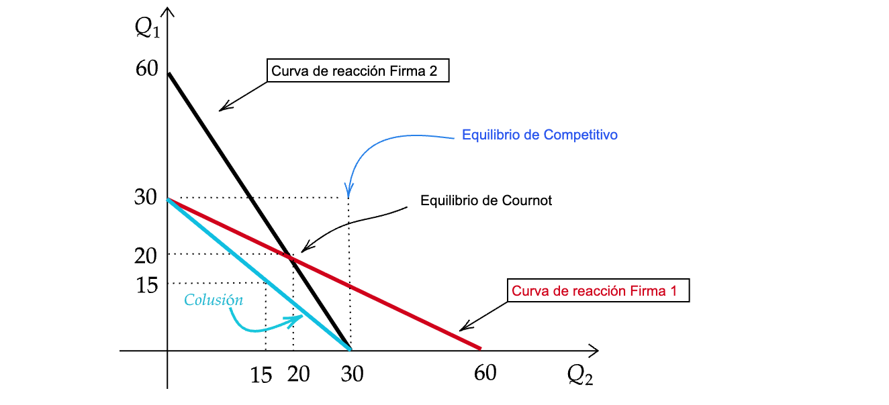

<!-- _class: "title-academic" -->
<!-- _backgroundColor: white -->

Introducción a la Teoría de Juegos

Cournot-Nash

Carlos A. Yanes Guerra

Barranquilla, 2026

Universidad del Norte - Departamento de Economía

---
<!-- _class: title -->

# Curso de teoría de **Juegos** 

## Microeconomía II | **Uninorte**

---
<!-- _class: toc  -->

1. [Inicio](#1)
2. [Contenido](#3)
3. [Sintesis](#8)
4. [Funciones de reacción](#11)
5. [Cournot Nash](#12)
6. [Referencias](#19)

---
<!-- _class: "nobrand" -->
<!-- _backgroundImage: url('https://media3.giphy.com/media/v1.Y2lkPTc5MGI3NjExY2N5ODQyeXBsa3BvYjVjNDVlMjg2eWlsMXlkYThrY3Q4OXowaDl3aiZlcD12MV9pbnRlcm5hbF9naWZfYnlfaWQmY3Q9Zw/UhtYWgakzIwAJXZ1gK/giphy.gif') -->
<!-- _backgroundSize: cover -->
<!-- _backgroundPosition: center -->

---

# Estructura de Mercado

- Estudiamos **Competencia perfecta**: Muchos *compradores* y Muchos
vendedores.
- Estudiamos **Monopolio**: Muchos *compradores* y un único vendedor.
- Ahora vamos a ver el `Oligopolio`: Muchos *compradores* y unos cuantos
vendedores.

---
# Oligopolio

- Es un **mercado** en que los productores  tienen poder de mercado.
- Sin embargo, se mantiene la competencia perfecta entre los demandantes.
- Se producen **interacciones estratégicas** entre productores.
- la herramienta de análisis, es el **equilibrio de Nash**.

- Solo unas pocas **firmas** producen la mayor parte del mercado.
- El producto puede ser no diferenciado .
- Existen **barreras** a la entrada de nuevas empresas.
- La **condición de óptimo** se da cuando el ingreso marginal se iguala a costo marginal.

---
# Algunos conceptos adicionales

- ### No cooperativos
    - **Fijando cantidades**
        - Cournot
        - Stackelberg
    
    - **Fijando precios**
        - Bertrand
        - Liderazgo de precios                                

- ### Cooperativos
    - **Cártel**: Las empresas se
ponen de acuerdo.
Cooperan entre sí para
elegir un nivel de
producción donde se
maximiza el beneficio de
todas ellas.

---
# En sintesis

# Cournot

Toman decision en simultaneo   Deciden sobre **cantidades**.

# Stackelberg

Hay una empresa **lider**   Las otras son seguidoras.

# Bertrand

Toman decisión en simultaneo   Deciden sobre precios .

# Liderazgo de precios

La empresa **lider** define   precio y la siguen las demas firmas.

---

 Vamos a la   "**Microeconomía**"

---
<!-- _class: "white-slide" -->
# Equilibrio de Cournot

<table style="border-collapse: collapse; width: 60%; margin: auto; text-align: center;">
  <caption style="caption-side: top; font-weight: bold; margin-bottom: 8px;">
    Producción de las firmas en duopolio
  </caption>
  <thead>
    <tr style="background-color: #FFCC67;">
      <th style="border: 1px solid black; padding: 8px;">
        <i><b>Decisión Firma 1</b></i>
      </th>
      <th style="border: 1px solid black; padding: 8px; color: #FE0000;">
        <b>Decisión Firma 2</b>
      </th>
    </tr>
  </thead>
  <tbody>
    <tr>
      <td style="border: 1px solid black; padding: 8px;">30</td>
      <td style="border: 1px solid black; padding: 8px;">0</td>
    </tr>
    <tr>
      <td style="border: 1px solid black; padding: 8px;">20</td>
      <td style="border: 1px solid black; padding: 8px;">20</td>
    </tr>
    <tr>
      <td style="border: 1px solid black; padding: 8px;">10</td>
      <td style="border: 1px solid black; padding: 8px;">40</td>
    </tr>
    <tr>
      <td style="border: 1px solid black; padding: 8px;">0</td>
      <td style="border: 1px solid black; padding: 8px;">60</td>
    </tr>
  </tbody>
</table>

- Un conjunto resultante de niveles de producción.
- En equilibrio cada **empresa** supone la producción de su competencia.
- El proceso de maximización se da dado lo que **produce** la otra firma.

---
# Gráfico de reacción

---
# Ejemplo de equilibrio

- Considere que existe la siguiente **función de demanda** :moneybag: :
$$P=30-Q$$

La cantidad que se produce por la existencia de **dos firmas** es:

$$Q=q_{1}+q_{2}$$

Asuma que el costo marginal es $Cmg_{1}=Cmg_{2}=0$, para ambas

---
# 📈 Ingreso Total e Ingreso Marginal de la Empresa (1)

Tomamos el ingreso **total** de la empresa (1):

$$
\begin{aligned}
I_{1} &= p q_{1} \\
      &= (30 - q) q_{1} \\
      &= 30 q_{1} - (q_{1} + q_{2}) q_{1} \\
      &= 30 q_{1} - q_{1}^{2} - q_{1} q_{2}
\end{aligned}
$$

Por el lado del **ingreso marginal** de la firma (1):

$$
Img_{1} = \frac{\partial I_{1}}{\partial q_{1}} = 30 - 2q_{1} - q_{2}
$$

---
# ⚖️ Condición de Producción Óptima de la Empresa (1)

Igualamos el **ingreso marginal** al **costo marginal** para despejar la forma de producción:

$$
Img_{1}: \; 30 - 2q_{1} - q_{2} = 0
$$

De donde se obtiene:

$$
\begin{aligned}
2q_{1} &= 30 - q_{2} \\
q_{1} &= \frac{30 - q_{2}}{2} \\
q_{1} &= 15 - 0.5 q_{2}
\end{aligned}
$$

---
# 🎯 Curvas de Reacción de las Firmas

Para el nivel de producto óptimo, se cumple la condición:

$$
Img = Cmg
$$

Por tanto, la **curva de reacción** de la empresa (1) es:

$$
q_{1} = 15 - 0.5 q_{2}
$$

De forma **simétrica**, la curva de reacción de la empresa (2) es:

$$
q_{2} = 15 - 0.5 q_{1}
$$

Ahora...  
solo queda **enfrentar las dos funciones** ⚔️

---
# ⚖️ Equilibrio de Cournot

El resultado de la igualación es:

$$
\begin{aligned}
q_{1} &= 15 - 0.5(15 - 0.5q_{1}) \\
q_{1} &= 15 - 7.5 + 0.25q_{1} \\
q_{1} &= 7.5 + 0.25q_{1} \\
q_{1} - 0.25q_{1} &= 7.5 \\
q_{1}(1 - 0.25) &= 7.5 \\
q_{1}(0.75) &= 7.5 \\
q_{1} &= \frac{7.5}{0.75} = 10
\end{aligned}
$$

Por la **simetría** del modelo, la producción de cada firma será:

$$
q_{1} = q_{2} = 10
$$

---
# ⚖️ Equilibrio de Cournot

El mercado completo es:

$$
q = 20
$$

Con un **precio de** \$10 💰

### 💬 Reflexiones finales

- ➡️ En los mercados siempre sobrevivirán aquellos empresarios que **innovan constantemente** e **invierten en reducir costos de producción**.  

- ➡️ Los mercados son **instituciones eficientes** para asignar bienes y recursos, pero **no lo son todo**.  
  *Pendientes del libre mercado.* 💡

---
<!-- _class: "black-slide" -->

---

# Referencias

1. OSBORNE, Martin J.; RUBINSTEIN, Ariel. **A Course in Game Theory**.  
   Cambridge, Massachusetts: MIT Press, 1994.

2. DIXIT, Avinash K.; SKEATH, Susan; REILEY, David H. **Games of Strategy**.  
   5ª edición. New York: W. W. Norton & Company, 2020.

3. WATSON, Joel. **Strategy: an introduction to game theory**.  
  3ª edición. New York: W. W. Norton & Company, 2016.

4. GIBBONS, Robert. **A Primer in Game Theory**.  
   New York: Harvester Wheatsheaf, 1992.

6. STRAUB, Paul G. **Theoretical Foundations of Game Theory**.  
   New York: Springer, 2022.

7. BINMORE, Ken. **Playing for Real: A Text on Game Theory**.  
   Oxford: Oxford University Press, 2007.

8. TUCKER, Albert W. **A Two-Person Dilemma**.  
   In: Kuhn, Harold W.; Tucker, Albert W. (Eds.). *Contributions to the Theory of Games, Vol. 1.*  
   Princeton: Princeton University Press, 1950.

9. SAFNER, Ryan. **Lecture Notes on Game Theory**.  
    Hood College, Department of Economics, 2021.  
    Disponible en: [https://ryansafner.com](https://ryansafner.com)

